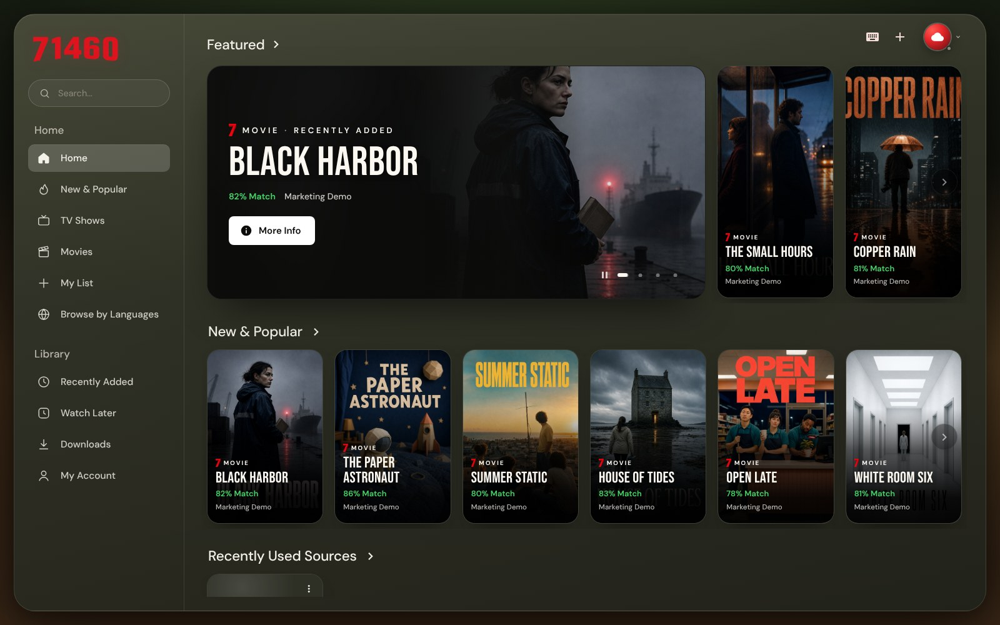

<p align="center">
  
</p>

# TiagoTV

Mi reproductor IPTV personal: listas **M3U/M3U8**, **Xtream Codes** y portales
**Stalker**, con una interfaz cinematográfica de vidrio — sidebar con
_Home / Library_, tarjeta destacada "Continue Watching", filas de pósters
"New & Popular" y tema oscuro cálido por defecto.



> TiagoTV no incluye listas ni contenido: solo reproduce las fuentes que
> cargues vos.

## Navegación

| Sidebar             | Qué abre                                                              |
| ------------------- | --------------------------------------------------------------------- |
| Home                | Inicio: "Continue Watching" (hero + tarjetas) y "New & Popular"       |
| New & Popular       | El catálogo de la fuente activa ordenado por valoración               |
| TV Shows            | Series de la fuente activa                                            |
| Movies              | Películas de la fuente activa                                         |
| My List             | Favoritos de todas las fuentes                                        |
| Browse by Languages | TV en vivo por categorías (los proveedores agrupan por país / idioma) |
| Recently Added      | Lo último que agregó el proveedor (Xtream)                            |
| Watch Later         | Historial para retomar lo que dejaste a medias                        |
| Downloads           | Descargas offline (app de escritorio)                                 |
| My Account          | Tus fuentes / cuentas IPTV (agregar, editar, vencimientos)            |

El avatar arriba a la derecha cambia la fuente activa (⌘/Ctrl + P).

## Mini-reproductor

Si salís de una película, serie o canal mientras se reproduce, sigue
sonando en la barra de abajo: miniatura con el video, título, cerrar,
−10 s / +10 s, play/pausa, repetir, tiempo, volumen y una línea de progreso
para saltar. Tocar la miniatura o el título vuelve a la página de origen; si
le das Play ahí, la barra se cierra (se reproduce una sola cosa a la vez).
La posición se guarda, así que "Continue Watching" retoma donde quedó.

## Servidor propio en tu red

La app de escritorio acepta IPs locales (`192.168.x.x`, `10.x.x.x`,
`localhost`) en las tres formas de conexión:

- **Lista M3U por URL**, por ejemplo `http://192.168.1.50:8080/videos.m3u`
  con una entrada `#EXTINF` + URL por video (o un archivo `.m3u` local).
- **Xtream Codes**: servidor `http://IP:puerto`, usuario y contraseña.
- **Stalker / Ministra**: URL del portal y MAC.

Para los formatos: MP4 (H.264/AAC), WebM, HLS y MPEG-TS se reproducen con el
reproductor integrado; MKV o HEVC/AC3 conviene abrirlos con MPV o VLC
(Settings → Playback). La guía EPG desde una IP local requiere arrancar la
app con `IPTVNATOR_ALLOW_PRIVATE_NETWORK_URLS=1`.

## Instalar en Mac

1. Entrá a **Releases** del repo y descargá `tiagotv-…-mac-arm64.dmg`
   (Mac con chip Apple).
2. Abrí el `.dmg` y arrastrá **TiagoTV** a **Aplicaciones**.
3. La app no está firmada por Apple, así que la primera vez macOS la
   bloquea. Abrí la **Terminal** y pegá:

    ```bash
    xattr -dr com.apple.quarantine /Applications/TiagoTV.app
    ```

    Después abrila normalmente. (Alternativa: intentá abrirla, y en
    **Configuración del Sistema → Privacidad y seguridad** tocá
    **Abrir de todos modos**.)

**Nueva versión:** en GitHub, **Actions → TiagoTV installer (macOS) → Run
workflow**. En unos 20–30 minutos aparece un release nuevo con el `.dmg`;
reemplazá la app en Aplicaciones (tus fuentes y favoritos se conservan) y
repetí el paso 3.

## Desarrollo

Requiere Node 22.22+ y pnpm 10 (`corepack enable`).

```bash
pnpm install
pnpm run serve:backend     # app de escritorio (Electron) con recarga
pnpm run serve:frontend    # solo la UI en el navegador (http://localhost:4200)
```

Para probar sin una cuenta real hay un servidor Xtream de prueba con
catálogo ficticio:

```bash
node --import tsx apps/xtream-mock-server/src/main.ts   # http://localhost:3211
```

y en la app: _Add playlist → Xtream_ con servidor `http://localhost:3211`,
usuario `marketing`, contraseña `marketing`.

## Compilar la app en tu compu

```bash
pnpm run build:backend
pnpm run make:app -- --publishPolicy=never   # instaladores en dist/executables
```

La firma y notarización de macOS están desactivadas para builds personales.
TiagoTV no busca actualizaciones de IPTVnator: se actualiza volviendo a
compilar desde este repo.

## Marca

- `branding/logo-71460.png` — wordmark del sidebar
- `branding/logo-7.png` — monograma (sidebar compacto, tarjetas)
- `branding/app-icon-1024.png` — ícono de la app (los tamaños están en
  `apps/web/src/assets/icons`)

## Créditos y licencia

TiagoTV es un fork de [IPTVnator](https://github.com/4gray/iptvnator) de
4gray, bajo licencia MIT (ver [LICENSE.md](LICENSE.md)). El nombre y el logo
de IPTVnator pertenecen a su autor ([TRADEMARK.md](TRADEMARK.md)); la
documentación original del proyecto está en
[docs/IPTVNATOR_README.md](docs/IPTVNATOR_README.md).
